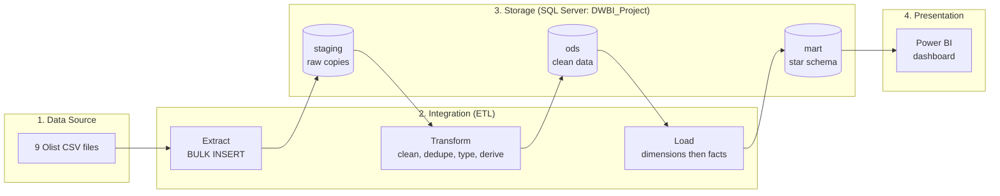
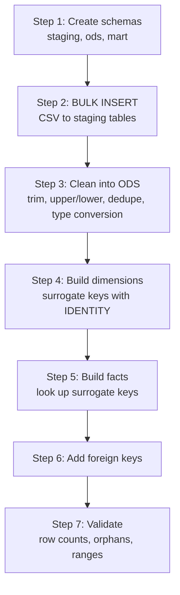
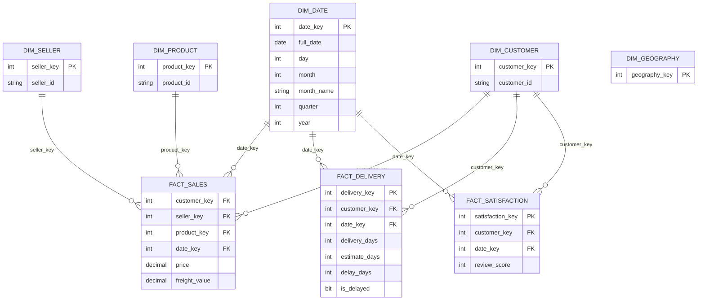
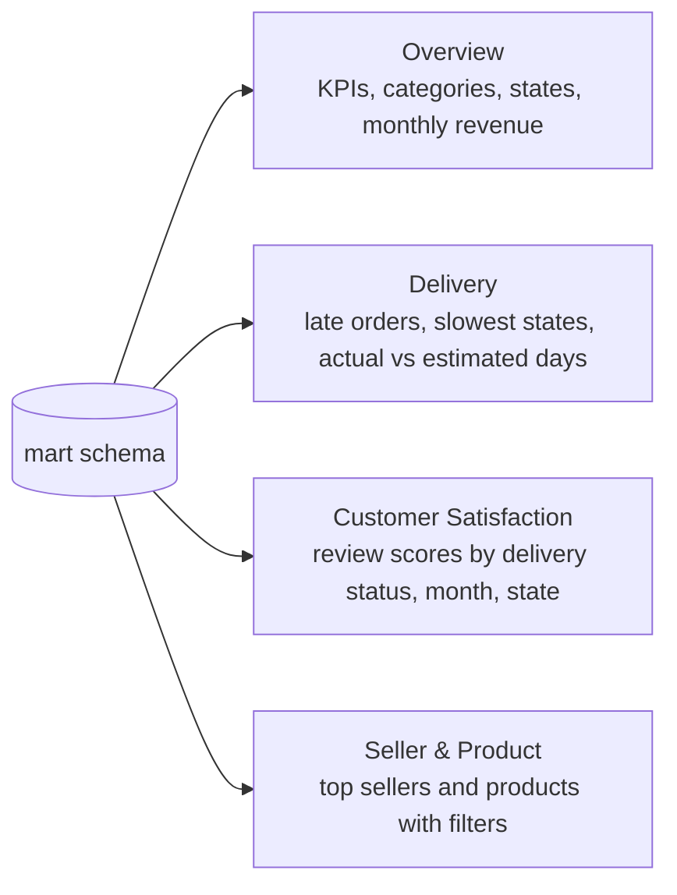

# End-to-End Data Warehouse & BI Solution: Olist E-Commerce

A data warehouse and Power BI dashboard built on the **Olist Brazilian E-Commerce** dataset.
It turns 9 raw files into one clean view of **sales, delivery, and customer satisfaction**.

Module: Data Warehousing and Business Intelligence (Group Assignment) Tool: SSMS, Power BI

## Table of Contents

1. [Business Problem](#business-problem)
2. [Dataset](#dataset)
3. [Architecture](#architecture)
4. [ETL Pipeline](#etl-pipeline)
5. [Star Schema](#star-schema)
6. [Data Mart](#data-mart)
7. [Power BI Dashboard](#power-bi-dashboard)
8. [Key Insights](#key-insights)
9. [Repository Structure](#repository-structure)
10. [How to Run](#how-to-run)
11. [Future Improvements](#future-improvements)
12. [Team](#team)

---

## Business Problem

Olist is an online marketplace. Its sales, delivery, and review data were spread over many raw files.
Managers had no single view of:

- What sells, and where
- How fast orders are delivered
- How happy customers are

We built a data warehouse and dashboard to answer these questions in one place.

---

## Dataset

| Item | Detail |
|---|---|
| Name | Olist Brazilian E-Commerce |
| Source | Kaggle (`olistbr/brazilian-ecommerce`) |
| Size | About 100,000 orders |
| Files | 9 CSV files |
| Period | 2016 to 2018 |
| Content | Orders, items, payments, reviews, customers, sellers, products, geolocation, category translation |

> The raw CSV files are **not** stored in this repo (file size). Download them from Kaggle.

---

## Architecture

The solution has four layers. Data flows from left to right.



| Layer | Schema | Purpose |
|---|---|---|
| Staging | `staging` | Raw CSV copies, no changes |
| ODS | `ods` | Cleaned, deduplicated, typed data |
| Data Mart | `mart` | Final dimensions and facts for analysis |

---

## ETL Pipeline



### Transformations

| Type | What we did |
|---|---|
| Cleansing | Removed rows with missing keys and invalid values (negative price or freight, review score outside 1 to 5) |
| Deduplication | `DISTINCT` and `ROW_NUMBER()` to keep one row per key |
| Standardization | `LTRIM`, `RTRIM`, `UPPER`, `LOWER` on city, state, status, and payment type |
| Missing values | `ISNULL` to set unknown product categories to `'unknown'` |
| Type conversion | `TRY_CONVERT` for review dates |
| Translation | Joined the category translation table (Portuguese to English) |
| Derived columns | Delivery days, estimated days, delay days, and late-delivery flag |

### Validation

- Orphaned foreign key checks on every fact table
- Range checks: price and freight not negative, review score between 1 and 5, delivery days between 0 and 365
- Row count checks between layers

---

## Star Schema

Three fact tables share conformed dimensions.



### Fact tables and grain

| Fact table | Grain (one row = ...) | Main measures |
|---|---|---|
| `Fact_Sales` | One order item | price, freight_value |
| `Fact_Delivery` | One delivered order | delivery_days, estimate_days, delay_days, is_delayed |
| `Fact_Satisfaction` | One review | review_score |

### Dimensions

| Dimension | Surrogate key | Notes |
|---|---|---|
| `Dim_Date` | `date_key` (yyyymmdd) | Calendar from 2016 to 2018 with year, quarter, month hierarchy |
| `Dim_Customer` | `customer_key` | Customer location |
| `Dim_Seller` | `seller_key` | Seller location |
| `Dim_Product` | `product_key` | Product and English category name |
| `Dim_Geography` | `geography_key` | City and state reference data |

### Slowly Changing Dimensions

- **Current design:** Type 1 (overwrite). The data is a one-time historical load, so no history columns are needed.
- **Future plan:** Type 2 for `Dim_Customer` and `Dim_Seller`, because locations change over time.

---

## Data Mart

| Item | Detail |
|---|---|
| Number of data marts | 1 |
| Name | Sales and Operations data mart |
| Schema | `mart` |
| Contents | `Fact_Sales`, `Fact_Delivery`, `Fact_Satisfaction`, and the 5 dimensions |
| Users | Sales managers, operations managers, executives |
| Purpose | A focused, fast, clean view of sales, delivery, and satisfaction that feeds Power BI |

---

## Power BI Dashboard

The dashboard connects to the `mart` schema and has 4 pages.



| Page | What it shows |
|---|---|
| Overview | Total revenue, orders, average order value, average review score; top categories and states; monthly revenue |
| Delivery | Average delivery days, on-time rate, late deliveries by month, slowest states, actual vs estimated days |
| Customer Satisfaction | Positive, neutral, and negative review share; reviews by score, month, and state; score by delivery status |
| Seller & Product | Top sellers and products with filters |

### OLAP operations

| Operation | Where | Purpose |
|---|---|---|
| Slice | Year filter on every page | View one year only |
| Dice | Year filter combined with state or category selection | Combine filters |
| Drill-down | Year → Quarter → Month in Monthly Revenue | Find the cause of a change |
| Roll-up | Month → Quarter → Year | See the big picture |

## Key Insights

1. **Sales trend:** Revenue peaked in November 2017 (about 1.18M) and stayed around 1M per month in 2018.
2. **Regions:** São Paulo gives about 37% of revenue (5.9M of 15.84M). SP, RJ, and MG together give about 62%.
3. **Categories:** The top 10 categories give about 62% of revenue. Health & Beauty is first (1.44M).
4. **Delivery:** About 92% of orders arrive on time with an average of 12.5 days, but some northern states, such as RR (29 days) and AP (27 days), take more than double.
5. **Customers:** The average review score is 4.09. Late deliveries lower review scores.

### Recommendations

- Prepare stock, ads, and delivery staff before the November peak.
- Protect the top states and grow the smaller ones with targeted offers.
- Improve delivery in slow northern states with better carriers or local warehouses.
- Make delivery estimates tighter and more accurate by state.
- Contact customers early when an order is late.

---

## Repository Structure

```
.
├── SSMS.sql                  # Schemas, staging load, ODS cleaning, star schema, fact and dimension loads
├── Cross Check.sql           # Validation queries
├── DWBI Project.pbix         # Power BI report (link below if too large for GitHub)
├── images/                   # Dashboard and diagram screenshots
└── README.md
```

> **Power BI file:** [Add download link here if the `.pbix` is over 25 MB]

---

## How to Run

**Requirements:** SQL Server, SQL Server Management Studio (SSMS), Power BI Desktop.

1. **Download the dataset** from Kaggle: [Olist Brazilian E-Commerce](https://www.kaggle.com/datasets/olistbr/brazilian-ecommerce).
2. **Create the database** in SSMS:
   ```sql
   CREATE DATABASE DWBI_Project;
   ```
3. **Open `SSMS.sql`** and update the `BULK INSERT` file paths to where your CSV files are saved.
4. **Run `SSMS.sql`** to create the schemas, load staging, clean into ODS, and build the `mart` dimensions and facts.
5. **Run `Cross Check.sql`** to validate row counts, keys, and value ranges.
6. **Open the Power BI file** and point the data source to your SQL Server and the `DWBI_Project` database (`mart` schema).

---

## Future Improvements

- **SCD Type 2** for customers and sellers to keep location history
- **Automated, incremental ETL** with SSIS or SQL Server Agent
- **Live data sources** (OLTP database or API) instead of CSV files
- **Fact_Payment** table for payment analysis
- **Geography link** from the fact tables to `Dim_Geography` for state-to-city drill-down
- **Performance tuning:** indexes and date partitioning
- **Power BI scheduled refresh** and row-level security
- **Data quality monitoring** with automatic alerts
- **Predictive analytics** for late deliveries and sales forecasting

---

## Tools

`SQL Server` · `SSMS` · `T-SQL` · `Power BI` · `Star Schema` · `ETL` · `OLAP`

---

## Team

| Name | GitHub |
|---|---|
| Christian Oersted Dominic Jeeva | [@Oersted12](https://github.com/Oersted12) |
| Ahamed M.A | [@username](https://github.com/username) |
| Umayanthi R.G.A.A | [@username](https://github.com/username) |

**Lecturer:** [Lecturer name], Lecturer in Charge of IT3101, SLIIT

---

## Acknowledgements

- Dataset: [Olist Brazilian E-Commerce](https://www.kaggle.com/datasets/olistbr/brazilian-ecommerce) on Kaggle
- Thanks to our lecturer for the guidance and feedback throughout the project.
